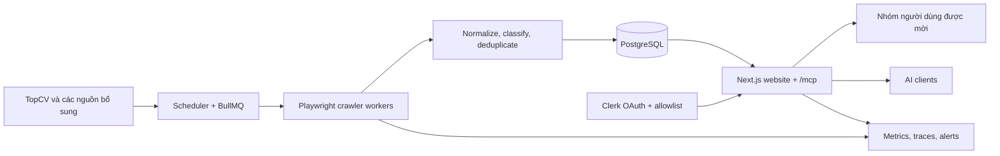

# Nghiên cứu website và pipeline dữ liệu việc làm

**Ngày kiểm chứng:** 15/10/2026  
**Thị trường:** Việt Nam, chỉ TP.HCM  
**Nhóm việc:** Content Marketing và truyền thông đa phương tiện  
**Nguồn chính mong muốn:** TopCV

## 1. Sản phẩm nên giải quyết gì

Website cần giúp người dùng trả lời nhanh bốn câu hỏi:

1. Hiện có việc nào phù hợp với chuyên môn của tôi tại TP.HCM?
2. Job yêu cầu làm nội dung gì, trên nền tảng nào và dùng công cụ nào?
3. Công ty này là ai, quy mô và địa chỉ ra sao?
4. Có tín hiệu đáng tin cậy nào về môi trường làm việc không?

Website không nộp hồ sơ thay người dùng ở MVP. Nút chính dẫn về URL ứng tuyển gốc và hiển thị nguồn, ngày thu thập, ngày kiểm tra gần nhất.

## 2. Kiểm chứng dữ liệu TopCV

Các trang job TopCV hiện có đủ dữ liệu để tạo một vertical search chất lượng:

- tiêu đề, công ty, lương, kinh nghiệm, học vấn;
- hạn ứng tuyển và trạng thái hết hạn;
- địa chỉ chi tiết, gồm cả tên phường mới và quận cũ;
- mô tả, yêu cầu, quyền lợi, lịch làm việc;
- quy mô, ngành và địa chỉ công ty;
- danh mục nghề, kỹ năng, số lượng tuyển và hình thức làm việc.

Ví dụ đang được index gồm [Video Editor tại Thế Giới Di Động](https://www.topcv.vn/viec-lam/video-editor/1910291.html), [Video Editor tại ATA](https://www.topcv.vn/viec-lam/video-editor/2246276.html) và [Nhân viên truyền thông đa phương tiện](https://www.topcv.vn/viec-lam/nhan-vien-truyen-thong-da-phuong-tien/2127681.html).

Kiểm tra ngày 15/10/2026 cho thấy:

- `https://www.topcv.vn/robots.txt` trả 200 và không disallow đường dẫn job;
- request HTTP trực tiếp vào `/viec-lam` trả 403;
- browser automation là phương án kỹ thuật thực tế hơn request thuần;
- trạng thái active phải dựa trên hạn nộp và việc URL còn truy cập được, vì search index vẫn giữ trang đã hết hạn.

### Ràng buộc kỹ thuật của nguồn TopCV

TopCV trả 403 cho HTTP client thông thường, vì vậy connector cần chạy bằng Playwright và được tách khỏi request của website/MCP. Crawler lưu dữ liệu đã chuẩn hóa cùng URL nguồn, dùng cache để tránh tải lại không cần thiết và tự động backoff khi gặp 403, 429 hoặc browser challenge.

Adapter cần có kill switch để tắt riêng TopCV khi layout thay đổi. Website và MCP vẫn phục vụ dữ liệu đã thu thập gần nhất, đồng thời hiển thị `last_verified_at` để người dùng biết độ mới.

## 3. Kiến trúc đề xuất



### Monorepo

```text
apps/
  web/        Next.js App Router, invite-only UI, API và MCP route
  worker/     scheduler, crawler và enrichment workers
packages/
  domain/     entities, taxonomy, ranking, policies
  db/         schema, migrations, repositories
  sources/    adapter interface và từng nguồn
  search/     query parsing, facets, ranking
  observability/
```

## 4. Stack đề xuất

| Thành phần | Chọn | Lý do |
|---|---|---|
| Ngôn ngữ | TypeScript | Chia sẻ model/schema giữa web, MCP và worker |
| Web | Next.js App Router | UI, BFF và web-standard MCP handler trong một service nhỏ |
| UI | Tailwind CSS + component primitives có accessibility | Ra MVP nhanh, dễ giữ hệ thống thiết kế nhất quán |
| Database | PostgreSQL | Transaction, JSONB, full-text, trigram và reporting trong một hệ thống |
| ORM | Drizzle ORM | Schema TypeScript nhẹ, migration rõ ràng |
| Queue | BullMQ + Redis-compatible store | Retry, backoff, scheduling và global rate limit cho crawler |
| Crawler | Playwright Chromium | Trang TopCV trả 403 cho HTTP client thường và cần browser rendering |
| Auth | Clerk | Đăng nhập web và OAuth cho remote MCP trong một nhà cung cấp |
| Observability | OpenTelemetry + Sentry-compatible error tracking | Trace từ crawl đến API/MCP, cảnh báo lỗi parser |
| Deploy | Render bằng Docker | Có web service, background worker, cron, Postgres và Redis-compatible Key Value |

Next.js App Router hỗ trợ Server Components và Route Handlers. Tài liệu cũng lưu ý handler serverless không phù hợp công việc dài; crawler vì vậy chạy ở worker riêng. Nguồn: [Next.js App Router](https://nextjs.org/docs/app), [Backend for Frontend](https://nextjs.org/docs/app/guides/backend-for-frontend).

BullMQ có worker, retry và global rate limit; phù hợp việc tôn trọng giới hạn từng nguồn và xử lý 429. Nguồn: [BullMQ workers](https://docs.bullmq.io/guide/workers), [rate limiting](https://docs.bullmq.io/guide/rate-limiting).

Render hỗ trợ background worker, cron, Postgres và Key Value trong cùng project. Nguồn: [Render service types](https://render.com/docs/service-types), [background workers](https://render.com/docs/background-workers).

## 5. Luồng crawl TopCV

1. Scheduler tạo crawl run theo keyword/role cluster và khu vực TP.HCM.
2. Worker mở browser context riêng, truy cập danh sách tìm kiếm và thu URL job.
3. Worker tải từng trang chi tiết với concurrency thấp và jitter.
4. Parser lấy field bằng selector và JSON-LD nếu có.
5. Validator từ chối record thiếu title, company, HCM hoặc apply URL.
6. Normalizer ánh xạ location, salary, experience, work type và role cluster.
7. Dedupe liên kết job occurrence với job canonical.
8. Job qua ngày hết hạn hoặc biến mất sau nhiều lần kiểm tra được đánh `inactive`.
9. Metrics so sánh số record và tỷ lệ field null với crawl trước để phát hiện giao diện đổi.

Mỗi adapter triển khai cùng interface:

```ts
interface JobSourceAdapter {
  discover(input: DiscoverInput): AsyncIterable<DiscoveredJob>;
  fetchDetail(ref: SourceJobRef): Promise<RawJob>;
  normalize(raw: RawJob): NormalizedJob;
  healthCheck(): Promise<SourceHealth>;
}
```

## 6. Taxonomy cho Content Marketing và multimedia

### Role clusters

- Content Marketing / Content Executive / Content Specialist
- Copywriter / SEO Content / Content Writer
- Social Media / Community / TikTok Content
- Marketing Communications / PR / Corporate Communications
- Video Editor / Videographer / Video Content Producer
- Multimedia Designer / Motion Graphic
- Creative Producer / Content Creator / Script Writer

### Trường chuyên môn cần trích xuất

- `platforms`: TikTok, Facebook, Instagram, YouTube, website, email;
- `content_types`: short video, long-form, SEO article, social post, livestream, event, internal communication;
- `creative_tools`: CapCut, Canva, Premiere, After Effects, Photoshop, Illustrator;
- `portfolio_required`;
- `on_camera_required`;
- `agency_or_inhouse`;
- `client_facing`;
- `weekend_or_shoot_schedule`;
- `kpi_types`;
- `languages`;
- `role_cluster` và confidence.

Rule-based extraction nên đi trước. LLM chỉ dùng cho field khó, chạy sau ingest, cache kết quả và lưu model/prompt version. Điều này giữ chi phí ổn định và cho phép kiểm tra lại.

## 7. Location normalization cho TP.HCM

Location cần giữ cả text nguồn và bản chuẩn hóa:

- thành phố: `Ho Chi Minh City`;
- đơn vị hiện hành: phường/xã;
- quận/huyện/TP Thủ Đức cũ nếu trang nguồn cung cấp;
- địa chỉ tự do;
- `is_hcm_verified` và confidence.

Search chấp nhận các biến thể `TP.HCM`, `HCM`, `Hồ Chí Minh`, `Sài Gòn`, tên quận cũ và tên phường mới. Remote chỉ được đưa vào kết quả khi job xác nhận người ở Việt Nam/TP.HCM có thể ứng tuyển.

## 8. Data model cốt lõi

| Bảng | Mục đích |
|---|---|
| `jobs` | Bản ghi canonical, field chuẩn hóa và trạng thái |
| `job_occurrences` | Một job ở từng nguồn, URL, source ID, timestamps |
| `companies` | Công ty canonical |
| `company_aliases` | Tên viết tắt, tên pháp lý và domain phục vụ dedupe |
| `locations` | Địa chỉ nguồn và đơn vị hành chính chuẩn hóa |
| `job_skills` | platform, tool, content type và kỹ năng |
| `company_feedback_sources` | Rating/summary, timestamp và confidence theo từng nguồn |
| `crawl_runs` | Trạng thái, metrics và lỗi mỗi lần crawl |
| `users` | Liên kết identity provider |
| `saved_jobs` | Job đã lưu của người dùng |
| `saved_searches` | Bộ lọc và tần suất thông báo sau MVP |
| `source_policies` | Cho phép crawl/display field nào, retention bao lâu |

`job_occurrences` tách khỏi `jobs` để một vị trí đăng ở nhiều nguồn vẫn là một kết quả, nhưng provenance không bị mất.

## 9. Search và ranking

MVP dùng PostgreSQL full-text search kết hợp:

- `unaccent` để tìm không dấu;
- `pg_trgm` để sửa lỗi gõ và fuzzy match;
- synonym map cho tên vai trò tiếng Việt/Anh;
- hard filter TP.HCM và active deadline;
- boost TopCV vì là nguồn chính;
- freshness, salary visibility và completeness;
- penalty cho title lệch ngành hoặc mô tả mang tính sales/telesales.

PostgreSQL cung cấp full-text search, `unaccent` và trigram index chính thức. Nguồn: [PostgreSQL Full Text Search](https://www.postgresql.org/docs/current/textsearch.html), [`unaccent`](https://www.postgresql.org/docs/current/unaccent.html), [`pg_trgm`](https://www.postgresql.org/docs/current/pgtrgm.html).

Một công thức điểm MVP có thể bắt đầu như sau và được hiệu chỉnh bằng click/apply-out data:

```text
score = 0.35 text_match
      + 0.20 role_match
      + 0.15 freshness
      + 0.10 source_priority
      + 0.10 field_completeness
      + 0.10 location_confidence
```

Không dùng vector database ở MVP. Phạm vi nghề hẹp và taxonomy rõ nên SQL search dễ giải thích, ít hạ tầng và rẻ hơn.

## 10. Website UX

Toàn bộ route sản phẩm yêu cầu tài khoản nằm trong email allowlist hoặc lời mời còn hiệu lực. Website gửi `noindex, nofollow`, không tạo public sitemap và `robots.txt` disallow toàn site.

### Trang tìm kiếm

- search box tiếng Việt;
- chip nhóm nghề;
- filter lương, kinh nghiệm, quận/phường, lịch làm, công cụ, portfolio;
- card job hiển thị lương, công ty, khu vực, kinh nghiệm, deadline, nguồn và độ mới;
- URL giữ toàn bộ filter để chia sẻ được.

### Trang chi tiết job

- tóm tắt vai trò và yêu cầu quan trọng;
- platform/tool/content type dưới dạng tag;
- lịch làm, portfolio, on-camera và client-facing;
- provenance và cảnh báo dữ liệu có thể thay đổi;
- CTA mở trang nguồn để ứng tuyển;
- job tương tự.

### Trang công ty

- thông tin đã xác minh, website và social chính thức;
- job đang mở;
- feedback theo nguồn, timestamp và số lượng review;
- phân biệt rõ `Thông tin do công ty cung cấp` và `Đánh giá bên thứ ba`.

### Tài khoản

- đăng nhập bằng Google/email;
- lưu job;
- quản lý saved search;
- xóa account và dữ liệu cá nhân.

## 11. Company feedback

Company feedback khó đồng nhất hơn job listing vì tên công ty có nhiều biến thể và số lượng review tại Việt Nam thường thấp. Indeed/Glassdoor có thể cung cấp rating và review count; các trang review Việt Nam bổ sung tín hiệu nhưng cần gắn confidence thấp hơn nếu không xác minh được danh tính người viết.

Chiến lược cho MVP:

1. Hiển thị thông tin công ty từ TopCV và website chính thức.
2. Lấy rating aggregate, review count, ngày cập nhật và link nguồn khi tìm thấy.
3. Không trộn rating giữa hai công ty chỉ vì tên gần giống; ưu tiên website domain và địa chỉ để match.
4. Tóm tắt xu hướng tích cực/tiêu cực, giữ liên kết về review gốc và không coi review đơn lẻ là kết luận.
5. User review do nền tảng tự thu thập để sau MVP vì cần moderation, report/appeal và chống spam.

## 12. Production readiness

- Docker image riêng cho web có MCP route và worker Playwright.
- PostgreSQL có backup và point-in-time recovery.
- Redis/Key Value persistent cho queue.
- staging và production tách database, OAuth app và secret.
- migration chạy như release step, không chạy đồng thời ở nhiều instance.
- health endpoints cho web, MCP, database, queue và từng source adapter.
- OpenTelemetry traces/metrics cho request, tool call, queue và crawl.
- alert khi parser success rate giảm, crawl không có dữ liệu, deadline invalid hoặc queue backlog tăng.
- CSP, secure cookie, CSRF protection, security headers, allowlist và rate limit cho mọi endpoint.
- quy trình xóa user data và retention cho logs.

OpenTelemetry JavaScript hỗ trợ traces và metrics ổn định cho Node.js. Nguồn: [OpenTelemetry JavaScript](https://opentelemetry.io/docs/languages/js/).

## 13. Những gì chưa nên đưa vào MVP

- tự động nộp hồ sơ;
- upload và phân tích CV;
- chat agent chạy LLM liên tục trong website;
- user-generated company reviews;
- vector database;
- mobile app native;
- crawl diện rộng ngoài nhóm nghề và TP.HCM.

Giữ phạm vi này giúp private beta tập trung vào chất lượng dữ liệu, độ mới, tìm kiếm và độ tin cậy của nguồn.

